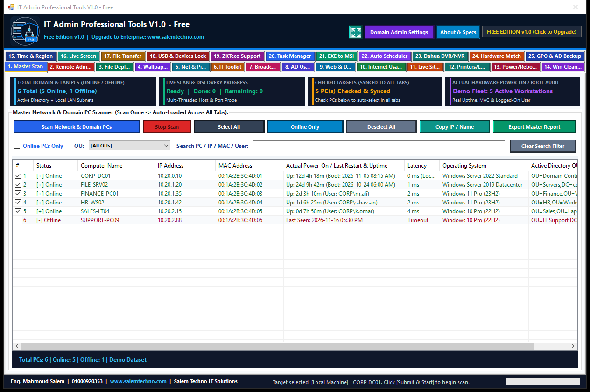
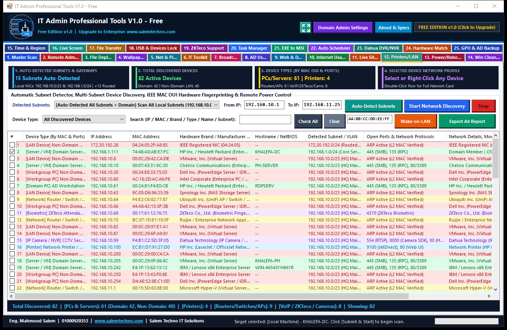
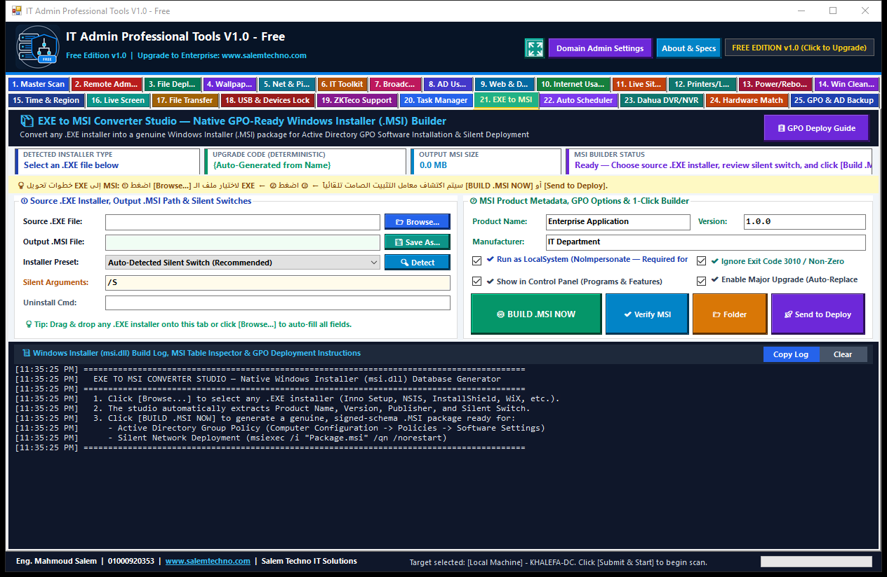
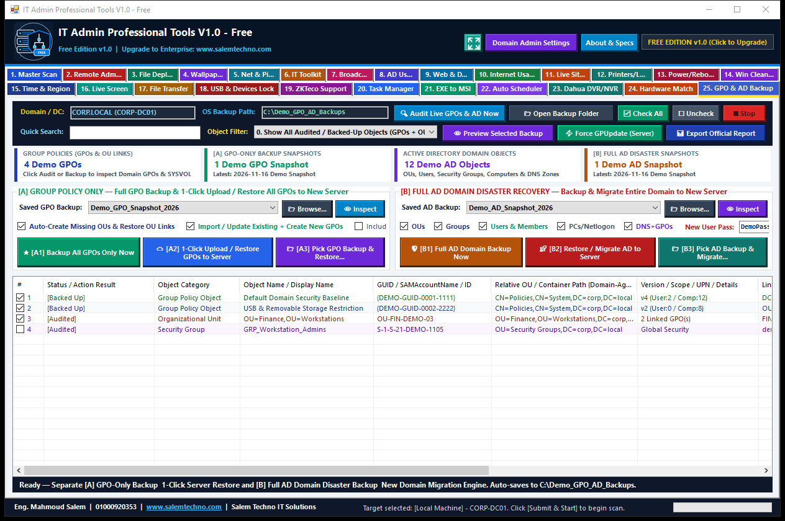
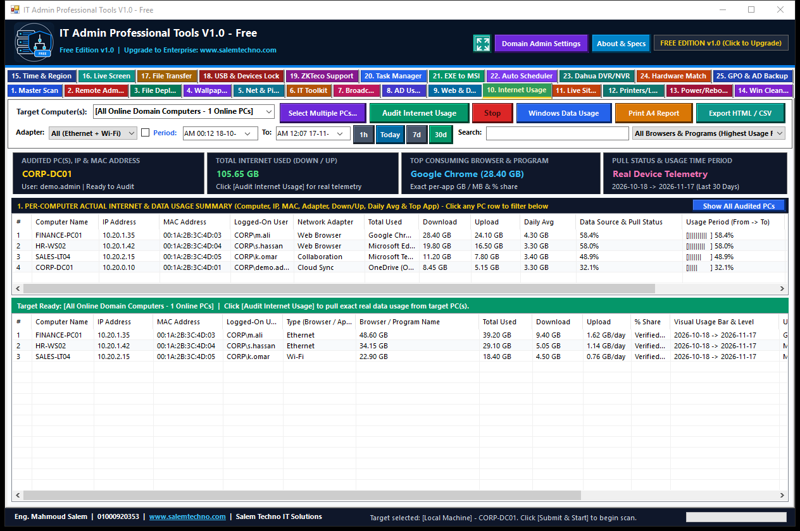
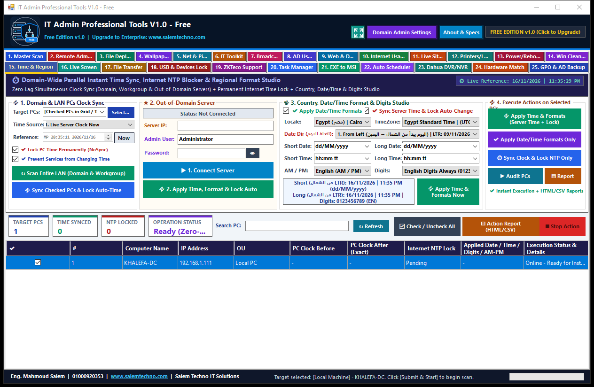

<div align="center">


# IT Admin Professional Tools V1.0 — Free Edition
### المنظومة المتكاملة لإدارة الشبكات وأنظمة الـ Active Directory والـ IT — النسخة المجانية الرسمية

[](https://www.salemtechno.com)
[-1e293b?style=for-the-badge)](https://www.salemtechno.com)
[](https://www.salemtechno.com)

**Architect & Lead Developer:** Eng. Mahmoud Salem | **Salem Techno IT Solutions**  
**Phone / WhatsApp:** `+20 01000920353` (`01000920353`) | **Official Website:** [https://www.salemtechno.com](https://www.salemtechno.com)

---

**🔑 Free Promotional Access Code (كلمة مرور تفعيل النسخة المجانية):** `Salemtechno.com`

</div>

---

## 📋 المحتويات | Table of Contents

- [نظرة عامة على البرنامج | Overview](#-نظرة-عامة-على-البرنامج--overview)
- [حزم التحميل والتثبيت | Release Packages & Repository Structure](#-حزم-التحميل-والتثبيت--release-packages--repository-structure)
- [لقطات شاشة حقيقية | Live Application Screenshots](#-لقطات-شاشة-حقيقية--live-application-screenshots)
- [الوحدات الـ 25 المدمجة | All 25 Integrated Modules](#-الوحدات-الـ-25-المدمجة--all-25-integrated-modules)
- [مقارنة بين Free Edition و Enterprise Edition](#-مقارنة-بين-النسخة-المجانية-والنسخة-المؤسسية--free-vs-enterprise)
- [طريقة التشغيل والنشر الصامت | Quick Start & Silent Deployment](#-طريقة-التشغيل-والنشر-الصامت--quick-start--silent-deployment)
- [التواصل والدعم الفني | Support & Licensing](#-التواصل-والدعم-الفني--support--enterprise-licensing)

---

## 🛡️ نظرة عامة على البرنامج | Overview

**IT Admin Professional Tools V1.0 (Free Edition)** هو برنامج سطح مكتب متكامل وعالي الأداء لمديري النظم ومهندسي الشبكات (System & Network Administrators)، يجمع **25 أداة وإدارة احترافية** داخل واجهة موحدة وسريعة لفحص الشبكة والـ Active Directory، متابعة استهلاك الإنترنت والمواقع، إدارة الأجهزة والطابعات وأجهزة البصمة وكاميرات المراقبة، إنشاء حزم التثبيت الصامت MSI، والنسخ الاحتياطي للـ GPO والـ Active Directory.

**IT Admin Professional Tools V1.0 (Free Edition)** is an all-in-one Windows IT & Network Administration suite delivering **25 integrated operational modules** inside one unified console — covering LAN & subnet device discovery, MAC vendor fingerprinting, traffic & active-site telemetry, GPO/AD diagnostics, EXE-to-MSI packaging, biometric/NVR tools, and system maintenance.

---

## 📦 حزم التحميل والتثبيت | Release Packages & Repository Structure

يحتوي هذا المستودع على حزم التشغيل والتثبيت الرسمية الجاهزة للاستخدام الفوري للنسخة المجانية:

| Folder | Package / Contents | Description (AR / EN) |
| :--- | :--- | :--- |
| **`1_Portable_Edition/`** | `IT Admin Professional Tools V1.0 Free.exe` | النسخة المحمولة المحمية — تعمل مباشرة بدون تثبيت / Portable protected single-file executable. |
| **`2_Setup_Installer_EXE/`** | `IT_Admin_Professional_Tools_V1.0_Free_Setup.exe` | مُثبّت ويندوز الاحترافي بواجهة رسومية كاملة + اختصار سطح المكتب + برنامج إلغاء تثبيت / Full GUI & Silent Installer (`/S`). |
| **`3_MSI_Enterprise_Package/`** | `IT_Admin_Professional_Tools_V1.0_Free_Setup.msi` | حزمة Windows Installer أصلية جاهزة للنشر عبر Group Policy (GPO) / SCCM / Intune. |
| **`4_Documentation_and_Guide/`** | `IT_Tools_Enterprise_Arabic_Guide_and_Video.html` | الدليل العربي التفاعلي المصور لاستخدام جميع التبويبات والأدوات. |
| **`5_Screenshots_and_Assets/`** | `00..06*.png`, Logos | لقطات شاشة حقيقية لواجهات النسخة المجانية وشعارات المنظومة الرسمية. |

---

## 📸 لقطات شاشة حقيقية | Live Application Screenshots

### 1. شاشة الترحيب والدخول للنسخة المجانية | Free Edition Access Screen
<div align="center">
  
</div>

### 2. الواجهة الرئيسية وشريط الـ 25 تبويباً | Main Dashboard & 25-Tab Suite
<div align="center">
  
</div>

### 3. تبويب اكتشاف الشبكات الفرعية والأجهزة بالـ MAC والخدمات | Multi-Subnet & MAC OUI Discovery (Tab 12)
<div align="center">
  
</div>

### 4. استوديو تحويل ملفات التثبيت EXE إلى حزم GPO (.MSI) | EXE to MSI Packager (Tab 21)
<div align="center">
  
</div>

### 5. النسخ الاحتياطي واستعادة الـ GPO والـ Active Directory | GPO & AD Backup Studio (Tab 25)
<div align="center">
  
</div>

<details>
<summary><b>📂 عرض مزيد من لقطات التبويبات | View Additional Module Screenshots</b></summary>
<br />

- **Tab 10 — Internet & App Data Usage Monitor:**  
  

- **Tab 15 — Time Sync & Regional Settings Studio:**  
  

</details>

---

## 🧩 الوحدات الـ 25 المدمجة | All 25 Integrated Modules

| # | Tab Name (In App) | الوظيفة الأساسية (Arabic Overview) | Key Capabilities (English) |
| :-: | :--- | :--- | :--- |
| **1** | `1. Master Scan` | الفحص المركزي لأجهزة الشبكة والدومين ومزامنة الأهداف | Central LAN / AD host scanner, OS, MAC & uptime telemetry |
| **2** | `2. Remote Admin` | إدارة النظام والخدمات والملفات عن بُعد | Remote services, processes & system administration tools |
| **3** | `3. File Deploy` | توزيع الملفات والسكربتات والتطبيقات | Package & software distribution workflow |
| **4** | `4. Wallpaper` | نشر وتثبيت خلفية الشركة وتوقيع بيانات الجهاز | Corporate wallpaper deployment & info stamping |
| **5** | `5. Net & Ping` | تشخيص الشبكة وفحص المنافذ والاتصالات | Multi-host ping, port checks & trace diagnostics |
| **6** | `6. IT Toolkit` | مجموعة الأدوات المتقدمة لفحص الثغرات والأمن | Security baselines, local audits, BitLocker & network checks |
| **7** | `7. Broadcast` | إرسال رسائل وتنبيهات إدارية للشبكة | Administrative alerts & user broadcast messaging |
| **8** | `8. AD Users` | إدارة مستخدمي Active Directory وفحص الحسابات | Domain user search, lockout & live logon session inspection |
| **9** | `9. Web & DNS` | تدقيق سجل المتصفحات وكاش الـ DNS | Browser URL history & Windows DNS resolver audit |
| **10** | `10. Internet Usage` | قياس استهلاك الإنترنت الفعلي لكل برنامج ومتصفح | Accurate per-application & browser data usage metrics |
| **11** | `11. Live Sites` | عرض المواقع المفتوحة حالياً في الوقت الحقيقي | Active open website & remote connection inspection |
| **12** | `12. Printers/LAN` | اكتشاف تلقائي لجميع الشبكات الفرعية ونوع كل جهاز بالـ MAC | Auto subnet detector, IEEE MAC OUI device discovery & WOL |
| **13** | `13. Power/Reboot` | التحكم في إعادة التشغيل والإيقاف والتنبيه | Graceful shutdown, reboot & scheduling actions |
| **14** | `14. Win Cleaner` | تنظيف ملفات النظام المؤقتة وكاش التحديثات | Safe system & temp storage cleanup utility |
| **15** | `15. Time & Region` | ضبط الوقت والمناطق الزمنية وصيغ التاريخ والأرقام | Time sync control, timezone & English/LTR regional formats |
| **16** | `16. Live Screen` | استعراض شاشة الجهاز والدعم الفني | Live remote assistance & screen inspection tools |
| **17** | `17. File Transfer` | نقل الملفات السريع والمباشر | Fast direct administrative file transfer studio |
| **18** | `18. USB & Devices Lock` | التحكم في منافذ USB ووحدات التخزين | USB storage & peripheral device policy lockdown |
| **19** | `19. ZKTeco Support` | مزامنة أجهزة البصمة ZKTeco واكتشافها عبر الشبكة | ZKTeco device multi-subnet discovery & time sync |
| **20** | `20. Task Manager` | مدير المهام والعمليات المباشر | Detailed process monitor, CPU/RAM usage & termination |
| **21** | `21. EXE to MSI` | تحويل أي ملف تثبيت EXE إلى حزمة MSI جاهزة للـ GPO | Native `.msi` builder for GPO & silent enterprise deployment |
| **22** | `22. Auto Scheduler` | جدولة المهام الدورية والتنفيذ التلقائي | Automated task scheduling across maintenance windows |
| **23** | `23. Dahua DVR/NVR` | اكتشاف وفحص أجهزة تسجيل كاميرات Dahua | Dahua NVR/DVR network audit & status tools |
| **24** | `24. Hardware Match` | مقارنة مواصفات الأجهزة ومطابقة العتاد | Workstation hardware fingerprint & asset verification |
| **25** | `25. GPO & AD Backup` | النسخ الاحتياطي واستعادة سياسات المجموعة والـ AD | GPO snapshot backup, inspection & disaster recovery helper |

---

## ⚖️ مقارنة بين النسخة المجانية والنسخة المؤسسية | Free vs. Enterprise

| Capability / Feature | Free Edition (هذه النسخة) | Enterprise Edition (النسخة الكاملة) |
| :--- | :---: | :---: |
| **واجهة الـ 25 تبويب الكاملة & الاكتشاف الشبكي** | ✅ متاح (الجهاز المحلي + اكتشاف LAN) | ✅ **مفتوح بالكامل على مستوى الدومين** |
| **التنفيذ الجماعي على كل أجهزة الدومين (Bulk Fleet Scan & Action)** | ⛔ للجهاز المحلي فقط | ✅ **غير محدود لمئات الأجهزة دفعة واحدة** |
| **التحكم في صلاحيات المساعدين (Server / Client RBAC + Tabs Lock)** | ⛔ غير متاح | ✅ **تصدير نسخ Client مشفرة بصلاحيات مخصصة** |
| **نشر تغييرات جماعية عن بُعد (Remote Apps, File, GPO, Wallpaper Fleet)** | ⛔ محدود محلياً | ✅ **تنفيذ فوري متوازي على كامل الـ OUs والدومين** |
| **نظام التراخيص الموثق (أونلاين / أوفلاين + Single-PC Lock)** | — (كود مجاني موحد) | ✅ **تراخيص Lifetime / Subscription / Trial احترافية** |
| **الدعم الفني المباشر والتخصيص للمؤسسات** | Community / Docs | ✅ **دعم مباشر من م. محمود سالم + تحديثات أولوية** |

---

## 🚀 طريقة التشغيل والنشر الصامت | Quick Start & Silent Deployment

### Option A — النسخة المحمولة (Portable)
1. حمّل وشغّل الملف:  
   `1_Portable_Edition/IT Admin Professional Tools V1.0 Free.exe` *(بصلاحية Administrator)*
2. في شاشة الدخول اكتب كود التفعيل الترويجي المجاني:
   ```text
   Salemtechno.com
   ```
3. اضغط **Submit & Login to System**.

### Option B — مُثبّت الويندوز (Setup EXE)
- للتثبيت التفاعلي بالواجهة الرسومية: شغّل `2_Setup_Installer_EXE/IT_Admin_Professional_Tools_V1.0_Free_Setup.exe`
- للتثبيت الصامت (Silent):
   ```cmd
   IT_Admin_Professional_Tools_V1.0_Free_Setup.exe /S
   ```

### Option C — النشر عبر Group Policy / Intune (.MSI)
```cmd
msiexec /i "IT_Admin_Professional_Tools_V1.0_Free_Setup.msi" /qn /norestart
```

---

## 📞 التواصل والدعم الفني | Support & Enterprise Licensing

للحصول على **النسخة المؤسسية الكاملة (Enterprise Edition)** أو لطلب تراخيص الشركات والمؤسسات والتخصيص التقني:

- **المطور ومهندس المنظومة:** م. محمود سالم (`Eng. Mahmoud Salem`)
- **المؤسسة:** Salem Techno IT Solutions
- **الهاتف والواتساب المباشر:** `01000920353` (`+20 100 092 0353`)
- **الموقع الرسمي:** [https://www.salemtechno.com](https://www.salemtechno.com)

---

<div align="center">
  <sub>© 2026 Salem Techno IT Solutions — Designed & Engineered by Eng. Mahmoud Salem.</sub>
</div>
