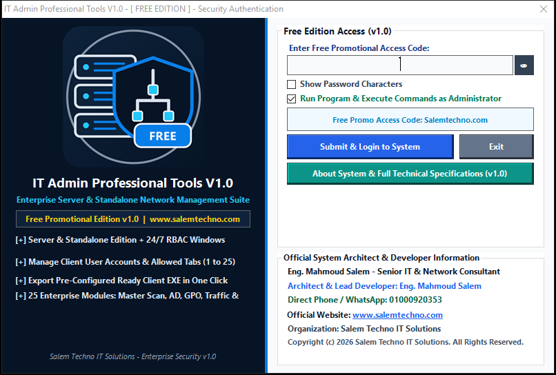

<div align="center">


# IT Admin Professional Tools V1.0 Free Edition
### المنظومة المتكاملة لإدارة الشبكات وأنظمة الـ Active Directory والـ IT النسخة المجانية الرسمية

[](https://www.salemtechno.com)
[-1e293b?style=for-the-badge)](https://www.salemtechno.com)
[](https://www.salemtechno.com)

**Architect & Lead Developer:** Eng. Mahmoud Salem | **Salem Techno IT Solutions**  
**Phone / WhatsApp:** `+20 01000920353` (`01000920353`) | **Official Website:** [https://www.salemtechno.com](https://www.salemtechno.com)

</div>

---

## 📋 المحتويات | Table of Contents

- [نظرة عامة على البرنامج | Overview](#-نظرة-عامة-على-البرنامج--overview)
- [حزم التحميل والتثبيت | Release Packages & Repository Structure](#-حزم-التحميل-والتثبيت--release-packages--repository-structure)
- [الشرح المصور الكامل لجميع التبويبات الـ 25 | Illustrated Guide to All 25 Tabs](#-الشرح-المصور-الكامل-لجميع-التبويبات-الـ-25--illustrated-guide-to-all-25-tabs)
- [الشرح المصور للنسخة المؤسسية (Enterprise Edition) | Enterprise Edition Showcase](#-الشرح-المصور-للنسخة-المؤسسية--enterprise-edition-complete-guide)
- [مقارنة بين Free Edition و Enterprise Edition](#-مقارنة-بين-النسخة-المجانية-والنسخة-المؤسسية--free-vs-enterprise)
- [طريقة التشغيل والنشر الصامت | Quick Start & Silent Deployment](#-طريقة-التشغيل-والنشر-الصامت--quick-start--silent-deployment)
- [التواصل والدعم الفني | Support & Enterprise Licensing](#-التواصل-والدعم-الفني--support--enterprise-licensing)
- [كلمة مرور تشغيل النسخة المجانية | Free Edition Promotional Password](#-كلمة-مرور-تفعيل-وتشغيل-النسخة-المجانية--free-edition-promotional-password)

---

## 🛡️ نظرة عامة على البرنامج | Overview

**IT Admin Professional Tools V1.0 (Free Edition)** هو برنامج سطح مكتب احترافي متكامل لمديري النظم ومهندسي الشبكات (System & Network Administrators)، يجمع **25 أداة وإدارة متخصصة** داخل واجهة موحدة وسريعة لفحص الشبكة والـ Active Directory، متابعة استهلاك الإنترنت والمواقع الحية، اكتشاف الأجهزة والطابعات بالـ MAC، إدارة أجهزة البصمة ZKTeco وكاميرات المراقبة Dahua، إنشاء حزم التثبيت الصامت MSI، والنسخ الاحتياطي للـ GPO والـ Active Directory.

> 💡 **ملاحظة:** جميع لقطات الشاشة المعروضة في هذا الدليل تم التقاطها باستخدام **بيانات تجريبية وهمية بالكامل (`CORP-DC01`, `10.20.x.x`)** حفاظاً على الخصوصية التامة.

---

## 📦 حزم التحميل والتثبيت | Release Packages & Repository Structure

| Folder | Package / Contents | Description (AR / EN) |
| :--- | :--- | :--- |
| **`1_Portable_Edition/`** | `IT Admin Professional Tools V1.0 Free.exe` | النسخة المحمولة المحمية — تعمل مباشرة بدون تثبيت / Portable protected single-file executable. |
| **`2_Setup_Installer_EXE/`** | `IT_Admin_Professional_Tools_V1.0_Free_Setup.exe` | مُثبّت ويندوز الاحترافي بواجهة رسومية كاملة + اختصار سطح المكتب + برنامج إلغاء تثبيت (`/S` للتثبيت الصامت). |
| **`3_MSI_Enterprise_Package/`** | `IT_Admin_Professional_Tools_V1.0_Free_Setup.msi` | حزمة Windows Installer أصلية جاهزة للنشر عبر Group Policy (GPO) / SCCM / Intune. |
| **`4_Documentation_and_Guide/`** | `IT_Tools_Enterprise_Arabic_Guide_and_Video.html` | الدليل العربي التفاعلي المصور الشامل لجميع الـ 25 تبويباً والنسخة الـ Enterprise. |
| **`5_Screenshots_and_Assets/`** | `Tab_01..Tab_25`, `Ent_01..Ent_04`, Logos | مكتبة الصور الرسمية للـ 25 تبويباً وشاشات النسخة الـ Enterprise ببيانات تجريبية. |

<div align="center">
  
</div>

---

## 🧩 الشرح المصور الكامل لجميع التبويبات الـ 25 | Illustrated Guide to All 25 Tabs

### Tab 1: `1. Master Scan` — الفحص المركزي للشبكة والدومين ومزامنة الأهداف
المركز الرئيسي لاكتشاف أجهزة الدومين والشبكة المحلية، عرض الاسم والـ IP والـ MAC الفعلي ووقت التشغيل والنظام الأساسي والـ OU، مع مزامنة الأجهزة المحددة تلقائياً عبر جميع التبويبات.
<div align="center">
  
</div>

### Tab 2: `2. Remote Admin` — مركز الإدارة والتحكم عن بُعد
تنفيذ أوامر الإدارة عن بُعد، إعادة تسمية الأجهزة والمستخدمين مع حفظ الملفات، إعادة تشغيل خدمة الطباعة Print Spooler، إصلاح أعطال الـ GPO والـ WMI، وتنفيذ استعلامات WMI مخصصة.
<div align="center">
  
</div>

### Tab 3: `3. File Deploy` — استبدال وتوزيع الملفات عبر كافة الأقسام
البحث الذكي عن ملف قديم داخل كافة البارتيشنات (`C:`, `D:`, `E:`) وإغلاق عمليته الجارية وأرشفته بالتاريخ واستبداله بالملف الجديد ثم إعادة تشغيله مع تقرير مفصل.
<div align="center">
  
</div>

### Tab 4: `4. Wallpaper` — نشر خلفيات الشركة وختم بيانات الجهاز
تطبيق خلفية سطح المكتب وشاشة القفل بدون الحاجة لـ Domain GPO، مع ختم اسم الجهاز والـ IP والمستخدم تلقائياً على الخلفية وقفل الصلاحيات لمنع تغييرها.
<div align="center">
  
</div>

### Tab 5: `5. Net & Ping` — فحص الشبكة والـ Ping المتعدد والمنافذ
قياس زمن الاستجابة (Latency ms) لمجموعة أجهزة في نفس الوقت مع تصنيف الحالة (`Low / Normal / High Latency`)، عرض المستخدم الحالي، وتصدير التقارير.
<div align="center">
  
</div>

### Tab 6: `6. IT Toolkit` — موسوعة الأدوات الهندسية والأمنية (9 تبويبات فرعية / 25 أداة)
مجموعة شاملة لفحص البرامج والخدمات، المدراء المحليين، فحص الثغرات، حالة الـ BitLocker، الجدار الناري، تشخيص Active Directory (`DCDiag`)، حماية Shadow Copies (`VSS`)، واكتشاف Rogue DHCP.
<div align="center">
  
</div>

### Tab 7: `7. Broadcast` — التعميم الإداري والرسائل المنبثقة التفاعلية
إرسال إشعارات وتنبيهات إدارية مصممة احترافياً (RTL/LTR) إلى شاشات المستخدمين مع متابعة حالة الاستلام وتأكيد القراءة من كل جهاز لحظياً.
<div align="center">
  
</div>

### Tab 8: `8. AD Users` — إدارة حسابات Active Directory والمستخدمين الأونلاين
استعراض جميع حسابات الدومين وحالتها، فك الحظر الفوري (`Unlock`)، إعادة تعيين كلمة المرور، إنشاء وتسمية الحسابات، ومراقبة الجلسات الحية للمستخدمين على الـ Domain Controller.
<div align="center">
  
</div>

### Tab 9: `9. Web & DNS` — تدقيق سجل المتصفحات وكاش الـ DNS
فحص المواقع المُزارة عبر المتصفحات (`Chrome / Edge`) وتدقيق كاش الـ DNS وحجم الاستهلاك مع فلاتر البحث والتاريخ وإمكانية التنظيف وحفظ التقارير.
<div align="center">
  
</div>

### Tab 10: `10. Internet Usage` — قياس استهلاك الإنترنت الفعلي لكل برنامج ومتصفح
تقرير موحد ودقيق لاستهلاك البيانات الحقيقي (`Download / Upload / Total / Daily Avg`) من خدمة استهلاك بيانات ويندوز الفعلية مصنفاً حسب الجهاز ثم حسب كل متصفح وبرنامج.
<div align="center">
  
</div>

### Tab 11: `11. Live Sites` — مراقبة المواقع المفتوحة حالياً في الوقت الحقيقي
رصد المواقع والاتصالات النشطة حالياً على الأجهزة (`Chrome / Edge / Teams / Connections`) مع عرض مدة الجلسة وحجم البيانات والـ Remote Server.
<div align="center">
  
</div>

### Tab 12: `12. Printers/LAN` — اكتشاف الشبكات الفرعية ونوع الأجهزة عبر MAC OUI
اكتشاف تلقائي لجميع الـ Subnets والـ VLANs، تصنيف الأجهزة (سيرفرات، طابعات، سويتشات، أجهزة بصمة، كاميرات) عبر بصمة المصنّع MAC OUI، فحص المنافذ، دعم Wake-on-LAN والتحكم بالطاقة.
<div align="center">
  
</div>

### Tab 13: `13. Power/Reboot` — التحكم الكامل في التشغيل وإعادة التشغيل والقفل
تنفيذ إعادة التشغيل أو الإيقاف الفوري أو المؤقت ببطاقة تنبيه للمستخدم (`Graceful Restart / Shutdown`)، مع خيارات تسجيل الخروج وقفل الشاشة والـ Wake-on-LAN.
<div align="center">
  
</div>

### Tab 14: `14. Win Cleaner` — منظف ويندوز الاحترافي وإنقاذ امتلاء بارتيشن `C:`
مسح ذكي لملفات النظام المؤقتة وكاش تحديثات ويندوز (`SoftwareDistribution`) وسلة المحذوفات والمتصفحات وتحرير الـ RAM، مع تحديد تلقائي للأجهزة ذات المساحة الحرجة (`< 5 GB`).
<div align="center">
  
</div>

### Tab 15: `15. Time & Region` — ضبط الوقت والـ NTP وصيغ التاريخ والأرقام
مزامنة فورية لساعة الأجهزة مع قفل التحديث التلقائي من الإنترنت (`NoSync`)، وضبط إعدادات الدولة والتوقيت واتجاه التاريخ (`LTR/RTL`) والأرقام الإنجليزية (`0123456789`) بضغطة واحدة.
<div align="center">
  
</div>

### Tab 16: `16. Live Screen` — استعراض الشاشات المباشر ودعم Shadow RDP
عرض حي لشاشة الجهاز، تشغيل Shadow RDP للمشاهدة أو التحكم الكامل (`Watch Only / Control`)، وإصلاح صلاحيات وجدار حماية الـ Shadowing والوصول لـ `C$`.
<div align="center">
  
</div>

### Tab 17: `17. File Transfer` — النقل المباشر للملفات إلى سطح المكتب أو أي مسار مخصص
إرسال الملفات مباشرة إلى سطح مكتب المستخدم النشط (`Active User Desktop`) أو إلى أي مسار مخصص على الأقراص مع إنشاء المجلدات تلقائياً وتسجيل النتائج.
<div align="center">
  
</div>

### Tab 18: `18. USB & Devices Lock` — حظر والتحكم بمنافذ USB ووحدات التخزين
تحكم دقيق في منافذ الفلاشات (`Block` / `Read-Only`)، الهواتف (`MTP`)، كروت الذاكرة (`SD`)، ومشاركة Hotspot/Wi-Fi دون تعطيل الماوس أو الكيبورد أو الطابعات المعتمدة.
<div align="center">
  
</div>

### Tab 19: `19. ZKTeco Support` — إدارة ودعم أجهزة البصمة ZKTeco واكتشاف الشبكات
اكتشاف أجهزة البصمة عبر الشبكات المختلفة، فحص بورت `4370`، التحقق من `CommKey`، مزامنة ساعة الماكينات وقفل `DST/NTP`، واختبار الشاشة والصوت وفتح الباب عن بُعد.
<div align="center">
  
</div>

### Tab 20: `20. Task Manager` — مدير المهام والعمليات الشبكي الشامل
عرض جميع البرامج والعمليات الجارية، استهلاك الـ RAM، تجميع البرامج المتكررة عبر الشبكة، وإغلاق أي برنامج أو عملية عن بُعد (`Force / Kill Tree`).
<div align="center">
  
</div>

### Tab 21: `21. EXE to MSI` — تحويل ملفات التثبيت `.EXE` إلى حزم `.MSI` للـ GPO
محول أصلي ينشئ حزم Windows Installer (`.msi`) متوافقة تماماً مع Active Directory Group Policy والنشر الصامت بالنظام (`LocalSystem`) مع اكتشاف تلقائي لمعامل التثبيت الصامت.
<div align="center">
  
</div>

### Tab 22: `22. Auto Scheduler` — المجدول الآلي للمهام والعمليات الدورية
6 معالجات جدولة مستقلة تعمل تلقائياً في أوقات محددة (إعادة التشغيل، إرسال التنبيهات، مزامنة الوقت والبصمة، إغلاق البرامج الممنوعة، إنقاذ الدومين، والتنظيف الدوري).
<div align="center">
  
</div>

### Tab 23: `23. Dahua DVR/NVR` — فحص وصيانة أجهزة تسجيل كاميرات Dahua
اكتشاف وفحص مسجلات Dahua عبر IP أو Serial P2P، التحقق من الوقت ومزامنته مع تعطيل DST، قراءة حالة الهارد الفعلي، حساب أيام التسجيل الفعلية والمتوقعة، وأخذ لقطات الكاميرات.
<div align="center">
  
</div>

### Tab 24: `24. Hardware Match` — مطابقة مواصفات الهاردوير وكشف تغيير القطع
أخذ بصمة ومواصفات العتاد التفصيلية لكل جهاز (`BIOS/Board SN, CPU, RAM Sticks, Disk Serials, GPU`) ومقارنتها بملف Baseline سابق لاكتشاف أي تغيير أو فقد في الرامات أو الهاردات.
<div align="center">
  
</div>

### Tab 25: `25. GPO & AD Backup` — النسخ الاحتياطي والاستعادة الشاملة للـ GPO والـ Active Directory
أخذ لقطات احتياطية كاملة لسياسات الـ GPO وروابط الـ OUs، وأخذ نسخة كاملة لهيكل الـ Active Directory (المستخدمين والمجموعات والأجهزة والـ OUs والـ DNS) لاستعادتها أو نقلها بضغطة زر.
<div align="center">
  
</div>

---

## 🏢 الشرح المصور للنسخة المؤسسية | Enterprise Edition Complete Guide

<div align="center">
  
</div>

صُممت **النسخة المؤسسية (Enterprise Edition)** لتمنح إدارات تكنولوجيا المعلومات والشركات الكبرى والمستشفيات والبنوك والفروع المتعددة تحكماً مركزياً غير محدود مع صلاحيات دقيقة للمساعدين وأعلى مستويات حماية التراخيص والتشغيل:

### 1. الإدارة الجماعية غير المحدودة على مستوى الدومين (`Server Console`)
في النسخة المؤسسية تنفتح جميع الـ 25 تبويباً بالكامل لتنفيذ الفحوصات والتعديلات على **مئات أجهزة الدومين دفعة واحدة** (توزيع برامج، قفل USB، تنظيف أقراص، مزامنة وقت، نسخ احتياطي، مراقبة حية)، مع شريط تحكم علوي متكامل للمدير العام.
<div align="center">
  
</div>

### 2. منظومة الصلاحيات المركزية (Server / Client RBAC) وتصدير نسخ المساعدين
إمكانية تشغيل خدمة خادم مركزية على مدار الساعة، إنشاء حسابات مخصصة لفريق الدعم الفني والمهندسين المساعدين، وتحديد **أي التبويبات من 1 إلى 25 مسموح لكل مستخدم فتحها** (مع إخفاء أو قفل التبويبات غير المصرح بها)، ثم تصدير نسخة **Client EXE جاهزة ومشفرة** تعمل تلقائياً لدى المساعد دون كشف كلمة مرور الدومين أبداً.
<div align="center">
  
</div>

### 3. الخزنة المركزية المحمية لبيانات Domain Admin
إعداد وتفعيل حساب مدير الدومين من نافذة موحدة تُطبق مركزياً ومشفرة عبر جميع الأقسام والأدوات دون الحاجة لإدخال البيانات في كل تبويب، مع عزل تام لكلمة المرور عن مستخدمي Client.
<div align="center">
  
</div>

### 4. نظام التراخيص الهجين وحماية الجهاز الواحد (`License & Activation`)
تدعم النسخة المؤسسية نظام تراخيص احترافي يربط كل رخصة بجهاز واحد بمرونة ذكية تحافظ على التفعيل عند إعادة تثبيت الويندوز، ويشمل:
- خطط متعددة: **مدى الحياة (`LIFETIME`)**، **اشتراك محدد المدة (`SUBSCRIPTION`)**، و**تجريبية (`TRIAL`)**.
- التفعيل **الأونلاين بالسيريال** عبر الموقع الرسمي `www.salemtechno.com` مع مزامنة صامتة دورية في الخلفية واستمرار العمل بسلاسة عند انقطاع الإنترنت.
- التفعيل **الأوفلاين** باستيراد ملف ترخيص مشفر (`.stlic`) أو لصق كود التفعيل مع عرض حالة الرخصة ومعرّف الجهاز (`DEVICE ACTIVATION ID`) وزر نسخ كود الطلب.
<div align="center">
  
</div>

---

## ⚖️ مقارنة بين النسخة المجانية والنسخة المؤسسية | Free vs. Enterprise

| Capability / Feature | Free Edition (هذه النسخة) | Enterprise Edition (النسخة الكاملة) |
| :--- | :---: | :---: |
| **واجهة الـ 25 تبويب الكاملة & الاكتشاف الشبكي** | ✅ متاح (الجهاز المحلي + اكتشاف LAN) | ✅ **مفتوح بالكامل على مستوى الدومين** |
| **التنفيذ الجماعي على كل أجهزة الدومين (Bulk Fleet Scan & Action)** | ⛔ للجهاز المحلي فقط | ✅ **غير محدود لمئات الأجهزة دفعة واحدة** |
| **التحكم في صلاحيات المساعدين (Server / Client RBAC + Tabs Lock)** | ⛔ غير متاح | ✅ **تصدير نسخ Client مشفرة بصلاحيات مخصصة** |
| **نشر تغييرات جماعية عن بُعد (Remote Apps, File, GPO, Wallpaper Fleet)** | ⛔ محدود محلياً | ✅ **تنفيذ فوري متوازي على كامل الـ OUs والدومين** |
| **نظام التراخيص الموثق (أونلاين / أوفلاين + حماية الساعة والجهاز)** | — (كود مجاني موحد) | ✅ **تراخيص Lifetime / Subscription / Trial احترافية** |
| **الدعم الفني المباشر والتخصيص للمؤسسات** | Community / Docs | ✅ **دعم مباشر من م. محمود سالم + تحديثات أولوية** |

---

## 🚀 طريقة التشغيل والنشر الصامت | Quick Start & Silent Deployment

### Option A | النسخة المحمولة (Portable)
1. حمّل وشغّل الملف:  
   `1_Portable_Edition/IT Admin Professional Tools V1.0 Free.exe` *(بصلاحية Administrator)*
2. في شاشة الدخول اكتب كود التفعيل الترويجي المجاني الموجود أسفل هذه الصفحة في قسم **كلمة مرور التشغيل المجانية**.
3. اضغط **Submit & Login to System**.

### Option B | مُثبّت الويندوز (Setup EXE)
- للتثبيت التفاعلي بالواجهة الرسومية: شغّل `2_Setup_Installer_EXE/IT_Admin_Professional_Tools_V1.0_Free_Setup.exe`
- للتثبيت الصامت (Silent):
  ```cmd
  IT_Admin_Professional_Tools_V1.0_Free_Setup.exe /S
  ```

### Option C | النشر عبر Group Policy / Intune (.MSI)
```cmd
msiexec /i "IT_Admin_Professional_Tools_V1.0_Free_Setup.msi" /qn /norestart
```

---

## 📞 التواصل والدعم الفني | Support & Enterprise Licensing

للحصول على **النسخة المؤسسية الكاملة (Enterprise Edition)** أو لطلب تراخيص الشركات والمؤسسات والتخصيص التقني:

- **المطور ومهندس المنظومة:** م. محمود سالم (`Eng. Mahmoud Salem`)
- **المؤسسة:** Salem Techno IT Solutions
- **الهاتف والواتساب المباشر:** `01000920353` (`+20 100 092 0353`)
- **الموقع الرسمي:** [https://www.salemtechno.com](https://www.salemtechno.com)

---

## 🔑 كلمة مرور تفعيل وتشغيل النسخة المجانية | Free Edition Promotional Password

لتشغيل **النسخة المجانية (Free Edition)** مباشرة عند ظهور شاشة الدخول أدخل كلمة المرور الترويجية التالية:

```text
Salemtechno.com
```

---

<div align="center">
  <sub>© 2026 Salem Techno IT Solutions. Designed & Engineered by Eng. Mahmoud Salem.</sub>
</div>
